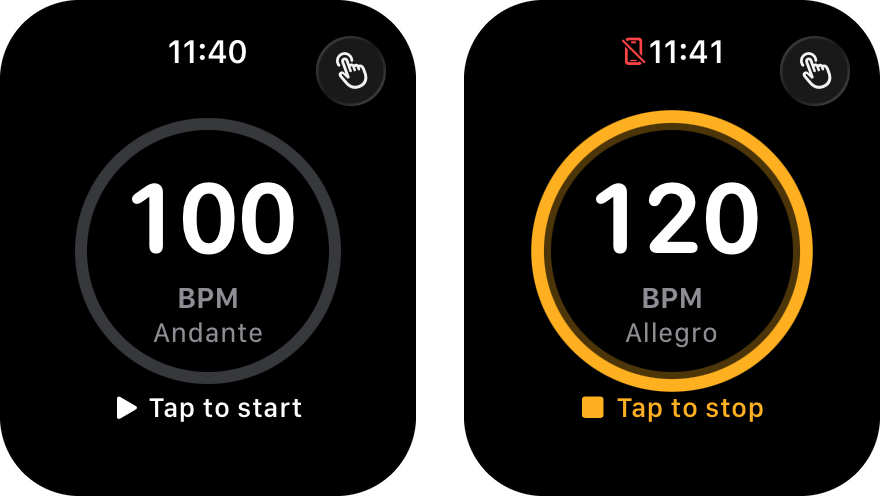
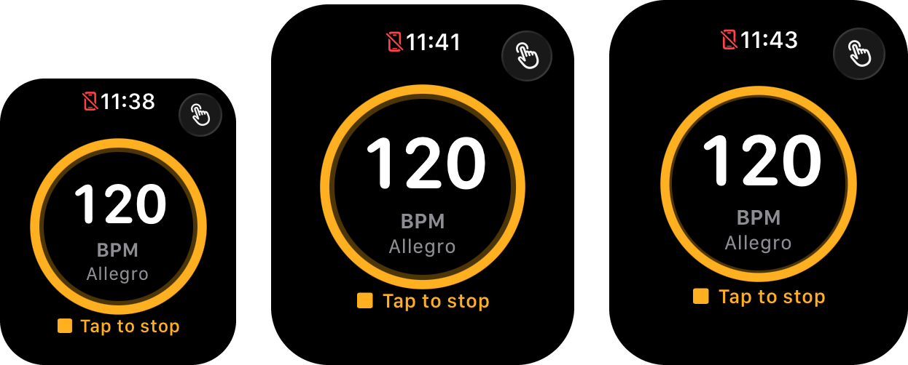

# Tactus

**A metronome you feel instead of hear, on Apple Watch. And Tactus Lab, which listens to you play and
tells you where you rush.**

[](https://github.com/FortakenJay/haptic-metronome/actions/workflows/build.yml)

<p align="center">
  
</p>

<sub>Watch simulator, Series 10 (46 mm). Left: stopped. Right: playing, caught on a beat. The red icon next to the clock is the
simulator saying no iPhone is connected; it isn't part of the app.</sub>

---

## A click you don't have to hear

A metronome click has to compete with the instrument. Play loud and you lose it. Play quietly and it's the
loudest thing in the room. Put it in headphones and it ends up in the recording. Every option means you end up
listening to the click instead of to yourself.

A tap on the wrist doesn't have that problem. Nobody else can hear it, it doesn't fight the sound you're making,
and you still notice it when your ears are busy.

*Tactus* is the old word for the beat in Renaissance music theory, and Latin for *touch*.

## What it does

**1. Turn the crown to set the tempo.** Turning the crown moves the tempo one BPM at a time, from 30 to 240. The
number changes immediately. Under it is the tempo's Italian name (Andante at 100, Allegro at 120), so you can
match a marking on the page without doing arithmetic.

**2. Tap anywhere to start.** The whole screen is the button. The first beat plays the moment you tap. Tap again
to stop.

**3. Every beat taps your wrist.** The ring lights up in time. While it plays, the crown's detent clicks are
switched off, so the only taps you feel are beats.

**4. Lower your wrist and it keeps going.** Tactus runs a watchOS *mindfulness* session, which keeps the app
running with the screen off for up to an hour. If it stops on its own, the screen says why and that a tap
restarts it.

**5. Pick how hard it taps.** The hand button at the top switches between **Light** (watchOS's lightest click)
and **Strong** (a firmer single tap). When the metronome is stopped, switching plays a sample beat.

**6. Odd meters, felt in their groups.** The button at the top left picks a time signature: 2/4 to 12/8,
including 5/4, 5/8, 7/8, 9/8 and 11/8 with their usual groupings. The first beat of each group taps Strong and the
rest tap Light, so 7/8 as 2+2+3 feels like *ONE two THREE four FIVE six seven*. Dots under the dial show the bar,
grouped the same way, and light up as you go. In /8 meters the tempo counts eighth notes.
[Meters](docs/wiki/Meters.md).

**7. It remembers.** Tempo, feel and meter are saved, so it opens where you left off.

| | |
|---|---|
| Tempo range | **30 to 240 BPM**, one BPM per crown detent |
| Meters | **16**: off, 2/4, 3/4, 4/4, 5/4 (3+2, 2+3), 6/8, 5/8 (3+2, 2+3), 7/8 (2+2+3, 3+2+2, 2+3+2), 9/8 (2+2+2+3, 3+3+3), 11/8, 12/8 |
| First beat | Immediately on tap |
| With the wrist down | Keeps going **up to 1 hour** (watchOS limit for this session type) |
| Network, accounts, Health data | **None.** Nothing leaves the watch |

## The timing

Each beat is scheduled from the time it was *supposed* to play, not from when the last buzz actually played.
If every buzz fires 30 ms late, beat 1,000 at 120 BPM is still due at exactly 500.000 s instead of 30 seconds
late. A test checks this.

Two more rules, both tested:

- **A stall skips beats instead of bunching them.** If watchOS holds the app up for longer than a beat, the beats
  it missed are dropped and the next one lands back on the grid. They never come out as a burst of buzzes.
- **A tempo change takes effect on the next beat.** The next beat comes one *new* interval after the last one, so
  turning the crown mid-bar never doubles up or skips a beat.

What the code can't control is the Taptic Engine itself. The schedule is exact, but each tap lands whenever the
hardware fires it. That's fine for practice. It isn't a sample-accurate click for syncing a recording.
[How it works](docs/wiki/How-it-works.md) has the details.

## Tactus Lab: am I rushing?

A metronome tells you where the beat is. It doesn't tell you that you get ahead of it every time the left hand has
sixteenths. That's what a teacher hears, and it's the hardest thing to hear in your own playing.

**Tactus Lab** is a second app that does that listening. It taps the beat on your wrist like Tactus, and while you
play it listens through the watch's microphone, finds the start of every note, and measures how early or late
each one is against the beat. A needle shows the last few notes live. When you stop, it sums up the take in one
sentence: *"You rush by 30 ms in the runs, on the beat elsewhere."* Below that come the numbers: overall timing,
steadiness, runs against everything else, and the two bars where you were furthest off.

It's a separate app on purpose. Tactus is the metronome you practise with and should never change under you.
Lab is where the experiments go. The two share only the tested timing code.

**How it listens.** Every 5 to 8 milliseconds it takes a short spectrum snapshot and keeps only the frequencies above 1 kHz.
A hammer hitting a string is loud up there for an instant. The watch's own tap and room hum aren't, so they never
count as notes. A threshold that adapts to the room picks the peaks. A small curve fit places each one to within
about a millisecond. Before any Swift existed, it was tuned in Python on synthetic piano takes with known timing:

| Case | Notes heard | Timing spread | Runs: measured (true) |
|---|---|---|---|
| Rushing in the runs | 99 % | 0.9 ms | −30.9 ms (−30) |
| Dragging in the runs | 99 % | 0.9 ms | +24.0 ms (+25) |
| Steady player | 99 % | 0.9 ms | −1.1 ms (0) |
| Noisy room | 72 % | 1.3 ms | −30.6 ms (−30) |

The Swift port is tested against the same kind of audio on every push. Calibrate once, by playing a key on 8
taps; that removes every constant delay at once: the Taptic Engine, the microphone, and your own habit of playing
a hair after the tap. Keep the watch in **Silent Mode** so it doesn't hear its own clicks; calibration checks for
that too. [Lab](docs/wiki/Lab.md) has the whole pipeline, the parameters and what it can't do yet.

## Run it on your own watch (free)

You need a Mac with **Xcode 16 or later**, an Apple Watch on **watchOS 26.6 or later**, and the iPhone it's paired
with. You don't need a paid developer account.

1. Open `Tactus.xcodeproj`.
2. Select the **Tactus** target, go to **Signing & Capabilities**, and under **Team** choose your Apple ID
   (*Personal Team*). If Xcode says the bundle identifier is taken, change `com.fortakenjay.tactus` to anything
   unique.
3. Turn on **Developer Mode** on the iPhone and on the watch (Settings → Privacy & Security). The option shows
   up after the device has been connected to Xcode once.
4. Pick the **Tactus** scheme and your Apple Watch as the destination, then press **Run**.
5. For Lab, do the same with the **TactusLab** scheme. It asks for the microphone the first time you start a take.

With a free Apple ID, Xcode's signing lasts **7 days**. After that the app won't open, so plug the iPhone in and
press Run again. A paid Apple Developer account makes an install last a year.
[Running it](docs/wiki/Running.md) lists the usual errors.

The timing logic has its own tests, which run without a watch:

```bash
swift test        # 34 tests: tempo, beat clock, meters, onset detector, timing analysis
```

GitHub Actions builds both watch apps and runs these tests on every push.

## Inside

SwiftUI and Observation for the screens, WatchKit for the haptics and the background session, AVFoundation and
Accelerate in Lab. Everything that decides *when* or *what* is plain Swift with tests. The apps on top are thin:

| Folder | In | What |
|---|---|---|
| `Core/` | both apps | Tempo rules, the beat schedule (`BeatClock`), meters and taps. Never reads a real clock |
| `Shared/` | both apps | The wrist-down session, taps → Taptic patterns |
| `Tactus/` | Tactus | The metronome, its screen, the meter picker and beat dots |
| `LabCore/` | Lab | Onset detection (`OnsetDetector`), timing analysis and summary, calibration |
| `Lab/` | Lab | Microphone, the take and calibration flow, needle and summary screens |
| `research/onset-prototype/` | | The Python prototype the detector was tuned with |

The same screen on a 40 mm, 46 mm and 49 mm watch:

<p align="center">
  
</p>

- [How it works](docs/wiki/How-it-works.md): the beat loop, the clock, the session, start to finish
- [Meters](docs/wiki/Meters.md): groupings, accents, how /8 tempos count
- [Lab](docs/wiki/Lab.md): the onset detector, timing analysis, calibration, validation
- [Interface](docs/wiki/Interface.md): the interaction and accessibility rules the screen follows, and where each lives
- [Decisions](docs/wiki/Decisions.md): what was chosen over what, and why, by component
- [Running it](docs/wiki/Running.md): setup and troubleshooting
- [Knowledge graph](docs/wiki/Knowledge-graph.md): a map of the code (439 nodes), built with graphify
- [Architecture](docs/ARCHITECTURE.md): states, data flow, invariants

## What it doesn't do yet

- **Three strengths of tap.** watchOS gives two (Light, Strong), so beat 1 and the start of a later group feel
  the same; the dots show where the bar starts.
- **Lab on a real piano.** The detector is validated on synthetic piano audio. It hasn't been measured against a
  real piano in a real room yet, and that's the next test.
- **Tap tempo.** No way yet to set the tempo by tapping it in.
- **More than an hour with the wrist down.** That's the cap for a mindfulness session. A workout session has no cap,
  but watchOS allows only one workout at a time, so it would end your run in the Workout app. Not worth it for a
  practice tool.
- **Measured on real hardware.** It hasn't been measured yet how fast the two feels stay distinct before they blur
  together near 240 BPM. If Strong blurs at fast tempos, use Light.

## How this was built

Jih designed it: the crown sets the tempo, a tap starts it, the beat is a haptic. Odd meters and the rushing
detector were Jih's next asks. Claude wrote the code, the tests, the Python prototype and this documentation from
that design, following the interface rules in [Interface](docs/wiki/Interface.md). Every number in this README
comes from the code, its tests or `research/onset-prototype/evaluate.py`.
