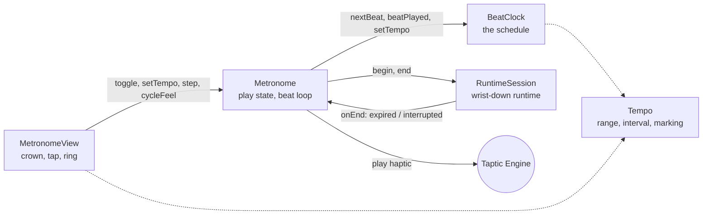

# How it works

From a tap on the screen to a tap on the wrist, and what happens when the wrist drops.

## The pieces



`Tempo`, `BeatClock`, `Meter` and `Feel` (dashed side) are plain Swift in `Core/` and are tested on a Mac with
`swift test`. The rest needs WatchKit.

## Starting

Tapping anywhere calls `Metronome.toggle()`, which calls `start()`:

1. Clears any notice from the last stop and sets `isPlaying`.
2. Records `origin`, the moment that counts as 0 s on the beat timeline (`ContinuousClock.now`).
3. Makes a fresh `BeatClock` with its first beat due at 0 s. That's why the first beat plays the moment you tap.
4. Starts the background session (below). watchOS only lets an app start one while it's active, and right after a
   tap it is.
5. Starts the beat loop.

## The beat loop

One `Task` on the main actor, repeating:

```swift
let due = origin + .seconds(clock.nextBeat)
try await Task.sleep(until: due, tolerance: .zero, clock: .continuous)
playBeat()   // tap from meter.tap(atBeat:feel:), beatInBar, beatCount += 1, clock.beatPlayed(at: now)
```

- It sleeps until an **absolute** time on `ContinuousClock`. It never sleeps for a relative "half a second", so
  small delays in waking up never add up.
- `tolerance: .zero` asks the system not to merge this wake-up with others to save power. A metronome is one of the
  few cases where that cost is worth paying.
- `beatCount` is the only thing the screen watches to flash the ring. The loop never touches the view.

Stopping cancels the task. The cancelled `Task.sleep` throws, and the loop returns.

## The clock

`BeatClock` holds two numbers, `interval` and `nextBeat`, both in seconds since `origin`. It never reads a real
clock: whoever calls it passes `now`. That's what lets the tests run 1,000 beats in no time.

| Event | What happens | Why |
|---|---|---|
| A beat played | `nextBeat += interval` | Measured from where the beat was due, not when it fired, so lateness doesn't accumulate |
| A beat played more than one interval late | Skip forward to the first beat after `now` | A stall (the system paused the app) never comes back as a burst of buzzes |
| Tempo changed | `nextBeat = (nextBeat − old interval) + new interval` | The next beat is one *new* interval after the last one. No jump, no double beat |

Changing the tempo while it plays also restarts the loop, because the old loop is asleep until the old next beat.
Turning the crown fires this on every detent. Cancelling and starting a `Task` costs next to nothing, so that's fine.

### Checked by tests (`Tests/TactusCoreTests`)

| Test | Checks |
|---|---|
| `testBeatsAreSpacedFromThePlanNotFromWhenTheyFired` | 1,000 beats at 120 BPM, each fired 30 ms late: beat *n* is still due at *n* × 0.5 s |
| `testAStallSkipsMissedBeatsInsteadOfBurstingThem` | At 60 BPM, beat 1 played at 3.4 s: beats 2 and 3 are skipped, next due at 4.0 s |
| `testALateBeatInsideOneIntervalSkipsNothing` | 0.9 s late at 60 BPM: nothing skipped |
| `testTempoChangeLandsOneNewIntervalAfterTheLastBeat` | 60 → 120 BPM puts the next beat at 0.5 s; then 30 BPM puts it at 2.0 s |
| `testTempoChangesDoNotAccumulateError` | Six changes ending back at 100 BPM: the next beat is still 0.6 s after the last |
| `testFirstBeatIsDueAtTheStart` | The first beat is due at 0 s |

Plus six in `TempoTests`: rounding and clamping (including NaN and infinity), 60 / BPM, exactly one marking for
every tempo from 30 to 240, and the Light/Strong flip.

## With the wrist down

Normally watchOS suspends an app a moment after the wrist drops, and the beats would stop with it.
`RuntimeSession` starts a `WKExtendedRuntimeSession` of type **mindfulness** (declared under `WKBackgroundModes`
in `Support/Info.plist`). For this type, Apple documents:

| | |
|---|---|
| Runtime | Frontmost: the app keeps running with the screen off |
| Time limit | 1 hour |
| Ends early when | You press the crown, open another app, or the system needs it to |
| Haptics | Allowed while the screen is off |

How each end is handled:

| How it ended | What Tactus does |
|---|---|
| You tapped stop | `end()` forgets the session first and then invalidates it, so its own "invalidated" callback is ignored |
| One-hour limit (`expired`) | Stops, and shows *Stopped after an hour* above *Tap to start* |
| Ended early, app still active | Starts a fresh session right away, up to 3 times per run. Past that, stops with *watchOS ended the session* |
| Ended early, app not active (wrist down, or left) | Stops, and shows *watchOS ended the session* |
| App comes back to the screen while playing with no session | Starts a fresh one (only allowed while active) |
| App leaves the screen while playing with no session | Stops, and shows *Stopped when you left* |

Without a session, keeping the beat loop going is not enough. Once the app isn't active, watchOS refuses the
haptics (`NSOSStatusErrorDomain Code=-536870187` in the console, once per beat), so the taps stop and the screen sits
still. That is the freeze seen on Jih's watch in the first build, which kept "playing" after a session ended. Now
the app either gets a new session or stops and says why.

The metronome is owned by `TactusApp`, not by the screen, so a SwiftUI view rebuild can't release a running
session either (watchOS logs that as *WKExtendedRuntimeObject was dealloced while running*).

Callbacks arrive off the main actor. Each one passes only the session's identity
(`ObjectIdentifier`) to the main actor, and a callback for a session that isn't the current one is ignored.

When the screen dims to Always On, `isLuminanceReduced` hides the beat ring and fades the dial. There's no
point animating a screen nobody is looking at, and Apple ends sessions that use too much CPU.

## Haptics

`WKInterfaceDevice.current().play(_:)` with:

| Feel | `WKHapticType` | Notes |
|---|---|---|
| Light | `.click` | The lightest tick watchOS has |
| Strong | `.start` | A firmer single tap |

Both also play a short sound unless the watch is in Silent Mode. That makes it an audible click too, if you
want one. The simulator has no Taptic Engine, so you only feel any of this on a real watch.
