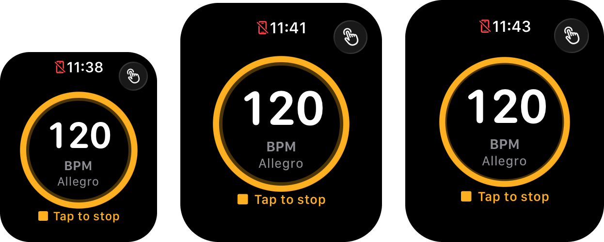

# Interface

One screen, two inputs: **the crown sets the tempo, a tap starts and stops it.** Everything else on the screen
is there so you can read the state at a glance without looking for more than a second, mid-practice.

```
            ◷ 10:09        ✋     ← feel: Light (outline) / Strong (filled)
          ╭───────────╮
         │    120     │          ← tempo, rounded digits, fixed width
         │    BPM     │
         │  Allegro   │          ← Italian marking for this tempo
          ╰───────────╯          ← ring: grey when stopped, amber when playing, flashes on each beat
          ■ Tap to stop          ← what a tap will do; icon and words change with state
```

On three watch sizes (simulator; 40 mm SE, 46 mm Series 10, 49 mm Ultra 2), playing at 120 BPM:



## Rules the screen follows

These come from the `better-ui`, `better-accessibility`, `better-typography` and `better-colors` skills used in
other repos (web rules, adapted to watchOS). The table shows the rule, how it applies here, and where it lives.

| Rule | Here | Where |
|---|---|---|
| High-frequency interactions respond instantly | The crown changes the number with no animation; it's turned dozens of times in a row | `MetronomeView.dial` (no transition on the `Text`) |
| Tabular numbers on changing values | `.monospacedDigit()` on the tempo, so 111 → 112 never shifts the digits sideways | `MetronomeView.dial` |
| Motion is never the only feedback | Playing changes the ring colour, the icon (▶ → ■) **and** the words (*Tap to start* → *Tap to stop*) | `MetronomeView.status`, `trackColor` |
| Colour is never the only cue | Amber means playing, but the icon and label say it too; Light vs Strong is outline vs filled hand **and** a spoken value | `status`, toolbar button |
| Press scales to 0.96 over 150 ms, ease-out | The whole screen gives slightly under your finger | `PressStyle` |
| Honour Reduce Motion | With Reduce Motion on, the beat ring only fades (no scale), the press fades instead of scaling, and the play/stop icon cross-fades instead of morphing | `reduceMotion` in `dial`, `PressStyle`, `status` |
| Cross-fade contextual icons on infrequent state changes | Play ↔ stop uses `.symbolEffect(.replace)` | `MetronomeView.status` |
| Expressive motion only for infrequent moments | The beat flash is the one animation that repeats, and it is short: 0.21 s in total, under one beat at the 240 BPM ceiling (0.25 s), so flashes never overlap | `dial` keyframes |
| Every control has an accessible name | Main button: *Start metronome* / *Stop metronome*. Feel button: *Beat feel*, value *Light* / *Strong* | `.accessibilityLabel` / `.accessibilityValue` |
| Every pointer interaction has a non-pointer path | VoiceOver swipe up/down changes tempo by one BPM (the crown's job); double-tap starts and stops | `.accessibilityAdjustableAction` → `Metronome.step(by:)` |
| A hit area as big as the job | The whole screen is the start/stop target, not just the label | `.contentShape(Rectangle())` on the full-size label |
| An error names the way out | If it stops on its own, the reason (*Stopped after an hour*, *Stopped when you left*) sits right above *Tap to start* | `MetronomeView.status` |
| One accent colour, one meaning | Amber (`#FFB020`, `AccentColor`) means *playing*. Nothing else uses it | `Assets.xcassets/AccentColor` |
| Outline for default, fill for active | Light feel is `hand.tap`, Strong is `hand.tap.fill` | toolbar button |

## Meters on the screen

| Rule | Here | Where |
|---|---|---|
| A control says what it holds | The top-left button shows the meter itself ("7/8"), or a note symbol when Off | `MetronomeView` toolbar |
| Disabled controls say why | With a meter set, the Feel button is disabled and VoiceOver reads "Set by the time signature" | `MetronomeView` toolbar |
| Grouping shown, not just stated | Beat dots are spaced by group (●○ ○○ ○○○ for 2+2+3); beat 1 is largest, group starts are brighter | `BeatDots` |
| Motion is never the only cue | The lit dot moves with the beat, and the grouping is also written under the tempo ("3+2+2") | `MetronomeView.subtitle` |
| Decorative stays out of VoiceOver | The dots are hidden from VoiceOver; the dial's value already says "7/8, 2 plus 2 plus 3" | `BeatDots`, `accessibilityValue` |
| Selected state is announced | The picker marks the current meter with a checkmark *and* the selected trait | `MeterPicker` |
| Always On stays quiet | The dots are hidden when the screen dims, like the beat ring | `MetronomeView` |

## Small things that are deliberate

- **Crown clicks go quiet while playing.** `isHapticFeedbackEnabled: !metronome.isPlaying`. Otherwise you'd feel
  the crown's detents mixed in with the beats while adjusting the tempo.
- **No focus ring.** The crown needs a focused view, and watchOS draws a ring around it. On a one-screen app that
  ring is noise, so it's off (`.focusEffectDisabled()`).
- **Switching the feel plays a sample** when stopped, so you know what you picked without starting the metronome.
  While playing, the next beat is the sample.
- **Always On.** When the screen dims, the beat ring is hidden and the dial fades to 60 %. There's nothing to
  watch, and less drawing means less CPU, which keeps watchOS from ending the session for using too much.

## What wasn't checked

- Watch sizes between the three captured above (41, 42, 44, 45 mm). The dial is drawn with
  `aspectRatio(1, contentMode: .fit)` and fits 40 mm and 49 mm without scaling the number, so the sizes between
  should too.
- Contrast of the grey ring when stopped. It's decoration (the label carries the state), but the pair hasn't been
  measured.
