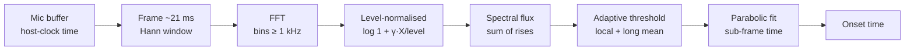

# Tactus Lab

Lab taps the beat on your wrist, listens to your piano through the watch's microphone, and measures how early or
late every note is. It's a separate app (bundle `com.fortakenjay.tactus.lab`) so the experiments in it never
touch Tactus, the metronome you practise with.

## A take

1. **Count-in.** Four Strong taps. The screen counts down.
2. **Play.** The click switches to Light taps on every beat. Every note the microphone hears is matched to the
   nearest point of the grid you picked: quarters ♩, eighths ♪, triplets 3, or sixteenths ♬. A needle shows the
   median of the last six notes: left is early, right is late, and the shaded middle is ±10 ms.
3. **Tap to stop.** The summary:

| Line | What it is |
|---|---|
| Headline | One sentence: *"You rush by 30 ms in the runs, on the beat elsewhere."* |
| Overall | Median deviation of every note on the grid |
| Steadiness | Robust spread: 1.4826 × median absolute deviation |
| In runs / Elsewhere | Median in beats with several notes (at least 3 of 4 sixteenths, 2 eighths) and in the rest |
| Furthest off | The two-bar stretch with the largest median, if it's 15 ms or more |
| Notes | How many matched the grid, and how many didn't (grace notes, ornaments, noise) |

Medians, not means: one wrong note shouldn't change the verdict.

## Calibration

Tap the tuning fork. Lab plays 4 Strong taps you **don't** play along to, then 8 Light taps you **do** play
along to, one key per tap.

- **The quiet taps** check whether the microphone hears the watch's own tap. If it does (onsets near at least
  half of them), Lab asks you to turn on Silent Mode. The tap's click sound is what it hears, and with it on,
  every beat would look perfectly on time.
- **The played taps** give your offset: the median of *your note minus the tap*. It is saved and subtracted from
  every take. It absorbs everything constant at once: the Taptic Engine's delay, the microphone's latency, the
  detector's own bias (about +1 ms), and how far after the felt tap you naturally play. After calibrating, "on the
  beat" means "where you play when you play with the click".

## How it hears a note

`LabCore/OnsetDetector.swift`, a Swift port of `research/onset-prototype/detect.py`.

| Step | Setting | Why |
|---|---|---|
| Frame | power of two ≥ 21 ms (1024 at 48 kHz, 512 at 16 kHz), hop a quarter of it | Long enough to resolve the spectrum, short enough that two notes rarely share a frame |
| Band | bins ≥ 1 kHz only | A hammer strike is broadband for an instant; the watch's Taptic buzz (~180 Hz) and room rumble are not. Tested: zero onsets from taps alone |
| Compression | log(1 + 10·\|X\|/level), level = slowly decaying peak (halves in ~7 s) | Same behaviour whether the mic hears the piano at 0.005 or 1.0 full scale |
| Flux | sum of positive changes between frames | Notes start; sustain and decay don't count |
| Threshold | peak ≥ local mean (~107 ms) + 0.4 × long mean (~2 s), local max within 3 frames before / 2 after, 30 ms apart | Adapts to the room and the dynamics; a rolled chord counts once |
| Warm-up | nothing reported in the first 20 frames | The threshold needs some history |
| Timing | frame centre + parabola through the peak and its neighbours | About 1 ms spread, against 5 ms frames |
| Latency | 2 frames of lookahead plus the audio buffer | The needle lags by a few tens of ms; the analysis doesn't, it uses the onset's own time |

### Validated on synthetic piano

`research/onset-prototype/evaluate.py` renders practice takes with known note times: harmonic partials with
per-partial decay, a hammer-noise burst, reverb, room noise, and the watch's Taptic buzz on every beat. Each take
alternates two bars of chords on the beat with two bars of sixteenth-note runs, and runs carry a set bias.

| Case | Notes heard | Precision | Timing spread | Runs measured (true) | Elsewhere measured (true) |
|---|---|---|---|---|---|
| Rushing runs, 48 kHz | 99% | 98% | 0.9 ms | -30.9 ms (-30) | +2.8 ms (+3) |
| Same, 16 kHz | 100% | 94% | 1.3 ms | -31.1 ms (-30) | +3.9 ms (+3) |
| Dragging runs | 99% | 99% | 0.9 ms | +24.0 ms (+25) | +3.3 ms (+3) |
| Steady player | 99% | 97% | 0.9 ms | -1.1 ms (+0) | +2.2 ms (+0) |
| Noisy room (−35 dB) | 72% | 100% | 1.3 ms | -30.6 ms (-30) | -1.0 ms (+3) |

The noisy room misses a quarter of the notes, mostly the soft ones, but the verdict holds: medians don't need
every note. Getting there: the first version used strong compression (γ = 100) and a higher threshold (0.6) and heard only
12 % of the notes in the noisy room. Gentler compression (γ = 10), a 0.4 threshold and level normalisation
brought that to 72 % without adding false onsets, and made the result independent of how loud the mic hears the
piano.

The Swift tests (`Tests/LabCoreTests`) build the same kind of audio with a seeded generator and check: at least
95 % of notes heard and 90 % precision, timing spread under 3 ms, zero onsets from the Taptic buzz alone, the
same result at 1 % mic level, identical onsets whatever the buffer size, correct times across a dropped buffer,
and the end-to-end verdict on a take that rushes 30 ms in the runs.

## Clocks

Everything is on the **host clock** (`mach_absolute_time`, the one audio buffers are stamped with). The beat loop
sleeps on `SuspendingClock`, which runs on the same clock, and records each beat's *planned* host time. Every
onset is `buffer time + offset in buffer`, so the screen, the audio thread and the scheduler never need to agree
on anything but that one clock.

## What it can't do yet

- **Real piano, real room.** Validated on synthetic audio only. The first real test is the one that matters.
- **Chords count once.** Notes within 30 ms are one onset. Rolled chords are timed by where the roll starts.
- **Which hand rushed.** Lab hears onsets, not pitches. "The left hand rushes" would need pitch tracking.
- **Rubato.** It measures against a strict click. Deliberate rubato reads as rushing and dragging.
- **The grid is 4/4 for the summary's bars.** Meters live in Tactus; Lab counts bars of four beats.
- **An hour per take**, the mindfulness session limit.

## Code

| Piece | Where |
|---|---|
| Onset detector | `LabCore/OnsetDetector.swift` |
| Grid matching, summary, calibration | `LabCore/TimingAnalyzer.swift` |
| Microphone | `Lab/AudioInput.swift` (AVAudioEngine tap, `.record` / `.measurement`) |
| Take and calibration flow | `Lab/LabSession.swift` |
| Screens | `Lab/LabView.swift`, `Lab/TimingNeedle.swift`, `Lab/SummaryView.swift` |
| Prototype | `research/onset-prototype/` (`synth.py`, `detect.py`, `evaluate.py`) |
